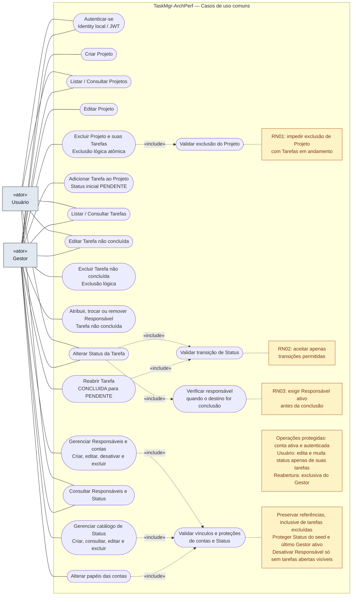

# Casos de uso — TaskMgr-ArchPerf

Especificação funcional comum às versões MVC e Clean Architecture, baseada na seção 3 do artigo `ARTIGO_CleanArchitecture_vs_MVC_v3-revisado.pdf`. Este diagrama reflete os requisitos funcionais aprovados; não indica funcionalidades já implementadas.

As linhas contínuas sem seta representam associações do ator. As setas `include` indicam verificações obrigatórias; a verificação de responsável só bloqueia a mudança quando o destino é a conclusão. Autenticação é uma precondição das operações de gestão, sem exigir novo login a cada operação. Os CRUDs de Responsável e Status estão agrupados para facilitar a leitura.

## Regras e critérios de aceitação

As decisões estão em [Requisitos funcionais](../requisitos-funcionais.md), incluindo matriz de transições, permissões, exclusões e CA01–CA34. O Usuário pode editar e alterar o status somente de tarefas atribuídas a ele, respeitando a matriz. Reabertura é exclusiva do Gestor e aparece separadamente para destacar sua permissão; é uma modalidade de alteração de status. As associações do diagrama não dispensam essas condições.

O fluxo principal é PENDENTE → EM_ANDAMENTO → CONCLUIDA. EM_ANDAMENTO pode retornar a PENDENTE. CONCLUIDA só retorna a PENDENTE por reabertura; saltos diretos de PENDENTE para CONCLUIDA ou de CONCLUIDA para EM_ANDAMENTO são proibidos. Mudanças dentro da mesma categoria e repetição do mesmo StatusId seguem as regras de idempotência aprovadas.

A exclusão de projeto sem tarefas em andamento inclui tarefas pendentes e concluídas, atomicamente. É uma exceção à proibição de exclusão individual de tarefa concluída. Referências impedem exclusão de Responsável/Status; tarefas visíveis não concluídas impedem desativação de Responsável. O próprio Gestor não pode excluir ou desativar sua conta. A validação de cadastros aplica as proteções pertinentes a cada operação.

O status inicial é PENDENTE. A conclusão exige responsável ativo. Projetos e tarefas têm exclusão lógica; referências a responsáveis e status são preservadas. Não houve verificação das tasks no Azure DevOps.
