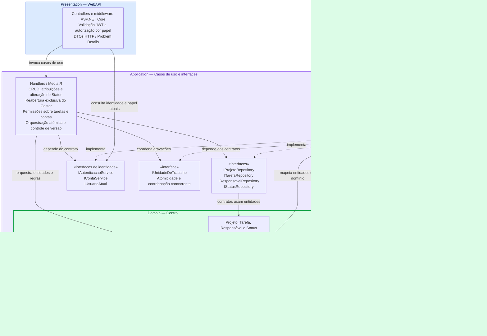

# Componentes — Clean Architecture

Arquitetura de referência para os requisitos de TaskMgr-ArchPerf, com quatro projetos: WebAPI, Application, Infrastructure e Domain. O banco definido para o projeto é PostgreSQL executado em container Docker, acessado por EF Core/Npgsql.

As setas representam dependências de código: as dependências entre camadas seguem para o interior, até Domain. As setas tracejadas indicam implementação de interfaces. Para visualizar em mermaid.live, copie apenas o conteúdo do bloco abaixo.

## Decisões e leitura do diagrama

- Domain aparece no centro conceitual, mas permanece um projeto separado de Application.
- As interfaces de repositório pertencem a Application. Seus contratos usam entidades de Domain, sem expor `DbContext` ou tipos do EF Core.
- Application carrega os dados necessários por interfaces e invoca as regras de Domain. Infrastructure fornece as implementações concretas por injeção de dependência.
- PostgreSQL é um processo externo em Docker. Sua indicação no componente de persistência identifica a tecnologia utilizada; não significa que o banco seja uma classe ou dependa de Domain. Conexões SQL e respostas em tempo de execução não são representadas pelas setas deste diagrama.
- A referência de WebAPI para Infrastructure existente no projeto local deve ficar restrita à composição de dependências em `Program.cs`. Esse vínculo de inicialização está fora do recorte funcional acima; controllers devem depender de Application.
- MediatR está previsto no artigo. A autenticação aprovada usa Identity local e emissão explícita de JWT. `IAutenticacaoService` abstrai login, `IContaService` gerencia contas e papéis e `IUsuarioAtual` fornece identidade validada, situação ativa e papel atual. Os nomes dos contratos são referências de implementação. Domain mantém apenas `UsuarioId`, sem depender de Identity.
- Application combina identidade atual e dados carregados para autorizar ações sobre tarefas; controles por papel na WebAPI não substituem essa autorização.
- `IUnidadeDeTrabalho` abstrai atomicidade e coordenação concorrente. Infrastructure coordena operações por projeto e protege atribuições concorrentes com desativação/exclusão de contas. Criação/exclusão de perfil e conta compartilham uma transação; exclusão de Projeto e suas Tarefas também é atômica.
- A exclusão lógica usa `ExcluidoEm`. Consultas normais ocultam registros excluídos; consultas de integridade de Responsável e Status consideram também tarefas excluídas. Domain define restrições e Application reúne os dados para aplicá-las.
- JWT dura 30 minutos, sem refresh token. Contas são criadas pelo Gestor; requisições protegidas verificam conta ativa e papel atual. Desativação e alteração de papel têm efeito imediato.

As regras aprovadas, permissões e critérios de aceitação estão em [Requisitos funcionais](../requisitos-funcionais.md). A validação funcional usa CA01–CA34 nas duas APIs, com o mesmo contrato HTTP e PostgreSQL isolado por execução.

